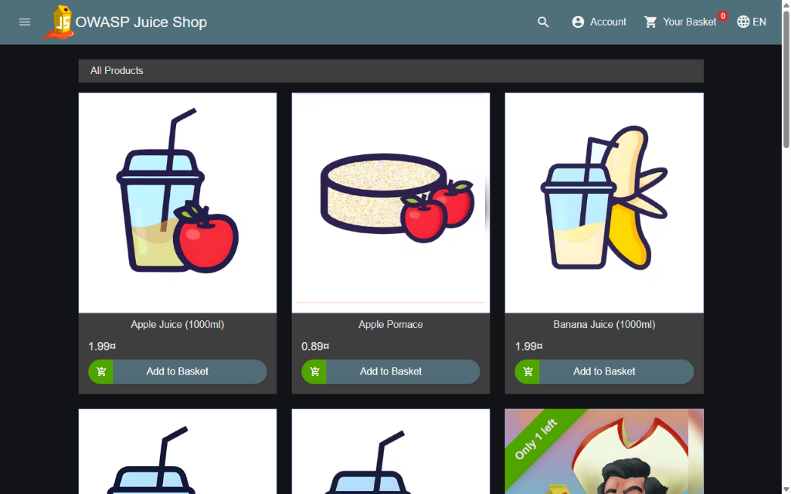
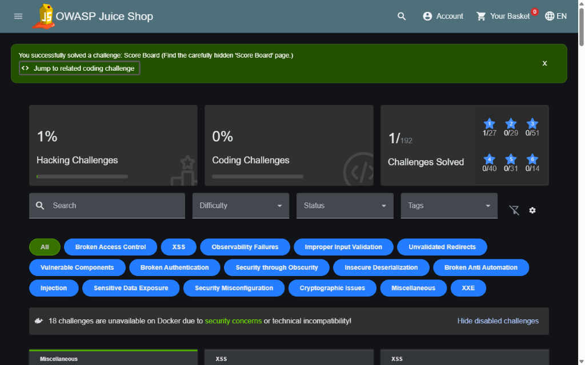
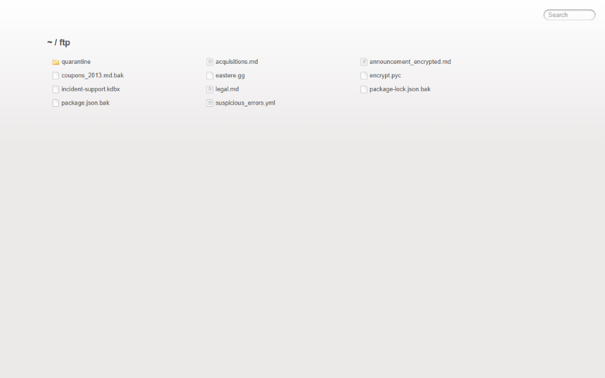

# 🤖 DIO Agent: Mentor de IA & Copiloto para Cibersegurança e Desenvolvimento

> **Seu mentor com Inteligência Artificial para aprender mais e melhor na [DIO](https://dio.me).**

O **DIO Agent** é um agente de IA que acompanha você na sua jornada de estudos e prática profissional. Ele conhece as experiências da DIO (Bootcamps, Formações, Cursos, Desafios e Carreiras) e atua tanto como mentor de aprendizado quanto como **copiloto técnico especializado em cibersegurança e simulação ofensiva (Red Team & Blue Team)**.

Você não precisa saber programar avançado nem instalar nada complicado: em **3 passos**, o seu mentor está pronto para usar em qualquer harness compatível com `AGENTS.md`.

---

## ✨ Três palavras para começar

- 🧠 **Agente de IA:** um chatbot apenas responde perguntas. Um *agente* vai além: lê, planeja, inspeciona e executa passos para ajudar você a alcançar um objetivo. É a diferença entre alguém que explica o caminho e alguém que caminha junto com você.
- 🖥️ **Harness:** é o programa onde o agente roda. O agente é o mentor, e o harness é a sala onde vocês se encontram. O mesmo mentor atende em salas diferentes, por isso o DIO Agent funciona em vários harnesses.
- 🧩 **Skill:** é uma habilidade do agente, descrita em um guia passo a passo. Você não precisa chamar a skill manualmente: o agente percebe o que você precisa e ativa a certa sozinho.

Esses e outros termos estão no [Glossário](docs/glossary.md).

---

## 🎯 A especialização do agente e por quê

Em vez de responder com textos genéricos ou scripts perigosos de ataque, o **DIO Agent** age como um **profissional de AppSec/DevSecOps e mentor de cibersegurança**:

* **Visão Red Team:** Como um atacante real enxerga o alvo — mapeamento de rotas compiladas no cliente, identificação de superfícies não referenciadas na URL, análise de parâmetros booleanos ("Sim" vs "Não") e técnicas do MITRE ATT&CK / OWASP Top 10.
* **Visão Blue Team:** Como proteger o sistema, como detectar a tentativa em logs/WAF e como aplicar código defensivo (*Prepared Statements*, *Route Guards*, validação no backend).

### Por que essa divisão de responsabilidade?
Um agente que sai disparando exploits destrutivos e força bruta descontrolada **é perigoso, aciona filtros de segurança de modelos de IA, derruba laboratórios e tira 100% do aprendizado do estudante**. 

Por isso, o DIO Agent adota uma **arquitetura de níveis de ação bem definida**:

| Nível | Nome | Quem Executa | Como Funciona |
|:---:|:---|:---:|:---|
| **0** | **Leitura & Análise** | **Agente sozinho** | Lê código-fonte, scripts, configs e documentação colados ou existentes no projeto. |
| **1** | **Coleta Passiva & Raio-X** | **Agente sozinho** | Mapeamento não agressivo no navegador integrado (`/browser`) e terminal: extração de rotas em bundles JS (`main.js`), verificação de cabeçalhos, cookies e diretórios expostos com **rate limit rigoroso (máx. 5 req/min — 1 req a cada 12s)**. |
| **2** | **Testes Não Refletidos & Inferência** | **Humano + Agente** | Testes lógicos e booleanos ("Sim" vs "Não", status HTTP, parâmetros de URL). O agente ensina a lógica e a ferramenta correta (Burp Suite, curl, DevTools) e o estudante executa o teste ativo no laboratório. |
| **3** | **Remediação & Relatório** | **Agente + Humano** | Estruturação de código seguro e geração de **Relatórios Técnicos de Pentest** prontos para portfólio profissional (com Matriz de Risco, CVSS, CWE e OWASP). |

---

## 🔬 O Diferencial: Testes Não Refletidos e Inferência Booleana ("Sim" vs "Não")

Muitos testes de iniciantes focam no clássico XSS refletido (injetar `<script>alert(1)</script>`), que apenas ecoa texto na tela. O verdadeiro diferencial exigido pelo mercado e implementado neste agente são as **vulnerabilidades não refletidas baseadas em URL e inferência lógica**:

1. **Exposição Direta de Recursos na URL:** Descobrir arquivos e diretórios confidenciais que não possuem links visíveis na interface, mas respondem diretamente via requisição HTTP GET comum (ex: `/ftp`, backups e cofres de senhas).
2. **Inferência Booleana ("Sim" vs "Não"):** Em vez de esperar mensagens de erro verbosas, o analista faz perguntas lógicas ao backend através de parâmetros na URL e observa a resposta binária:
   - **Condição Verdadeira ("Sim"):** A aplicação retorna status `200 OK` ou popula a lista de dados.
   - **Condição Falsa ("Não"):** A aplicação retorna lista vazia `[]` ou código de erro.
3. **Furtividade Absoluta:** Como não são enviados scripts invasivos, as requisições não poluem logs e passam de forma legítima pela infraestrutura.

---

## 📸 Caso Prático Real: Teste no OWASP Juice Shop

Durante os testes de laboratório no **OWASP Juice Shop** (`http://192.xxx.xx.xx:porta`), o agente aplicou essa metodologia na prática:

### 1. Abertura do Navegador Integrado (Live Browser)
Através do comando `/browser http://192.xxx.xx.xx:porta`, o agente e o estudante abriram a aplicação lado a lado no painel lateral do harness, fechando banners e inspecionando a Single Page Application (Angular).


*Figura 1: Reconhecimento da aplicação e catálogo no navegador integrado.*

### 2. Mapeamento Passivo de 38 Rotas sem Ruído (Nível 1)
Em vez de usar fuzzers barulhentos (como dirb ou gobuster), o agente desempacotou o bundle `main.js` do Angular carregado no próprio navegador. Essa análise estática revelou **todas as 38 rotas da aplicação**, incluindo:
* Rotas administrativas: `#/administration` e `#/accounting` (protegidas apenas por Guards locais no navegador via `localStorage`).
* Rotas sensíveis desprotegidas: `#/saved-payment-methods`, `#/wallet`, `#/privacy-security/data-export`.
* **Rota Oculta do Score Board:** `#/score-board` (acessada diretamente sem qualquer link público no menu).


*Figura 2: Acesso à rota interna `/#/score-board` após identificação passiva no código.*

### 3. Exposição Crítica via URL Direta: Diretório `/ftp` (Nível 1 & 2)
Acessando a URL direta `http://192.xxx.xx.xx:porta/ftp`, a aplicação respondeu com **SIM (HTTP 200)** e entregou a listagem completa de diretório, expondo:
* `incident-support.kdbx` — **Cofre criptografado de senhas do KeePass!**
* `coupons_2013.md.bak` — Arquivos de backup com cupons promocionais.
* `package.json.bak` / `package-lock.json.bak` — Versões exatas de dependências do servidor.


*Figura 3: Diretório `/ftp` exposto publicamente contendo o arquivo de cofre de senhas `incident-support.kdbx`.*

### 4. Relatório Profissional Gerado com Matriz de Risco
Todas as evidências foram consolidadas no documento oficial [`reports/PENTEST-REPORT-JUICESHOP.md`](reports/PENTEST-REPORT-JUICESHOP.md):

| Criticidade | Qtd | Finding Identificado |
|:---|:---:|:---|
| 🔴 **Crítica** | 1 | **Exposição de Diretório e Cofre de Senhas (`/ftp`):** Acesso direto ao KeePass `incident-support.kdbx` (CWE-548 / CWE-552). |
| 🟠 **Alta** | 1 | **Segurança Baseada no Cliente (CWE-602):** Telas `#/administration` e `#/accounting` validadas apenas no cliente (`localStorage`). |
| 🟡 **Média** | 1 | **Ausência de Route Guards em Dados Financeiros (CWE-284):** Telas de carteira e pagamentos desprotegidas no frontend. |
| 🟢 **Baixa / Info** | 1 | **Exposição de Rotas e Recursos Ocultos (CWE-200):** Painéis e módulos Web3 ocultados apenas por obscuridade. |

---

## 🚀 Comece em 3 passos

### 1️⃣ Instale um harness

Recomendamos o **Google Antigravity**, que tem limites de uso generosos para quem está começando, terminal integrado e navegador lateral webview. Mas qualquer harness da lista funciona:

| Harness | Documentação oficial |
|---------|----------------------|
| Google Antigravity (recomendado) | https://antigravity.google/docs |
| Claude Code | https://code.claude.com/docs |
| Codex | https://developers.openai.com/codex |
| OpenCode | https://opencode.ai/docs |
| Hermes | https://hermes-agent.nousresearch.com/docs |

### 2️⃣ Baixe o DIO Agent e abra no harness

Baixe este repositório do jeito mais simples para você:

- **Com Git:** no terminal, rode `git clone https://github.com/digitalinnovationone/dio-agent.git`
- **Sem Git:** no topo desta página, clique no botão verde **Code**, depois em **Download ZIP**, e extraia a pasta.

Depois, abra no harness a pasta do projeto (a que tem o arquivo `AGENTS.md`). O harness lê esse arquivo sozinho e o agente já está pronto para te mentorar.

### 3️⃣ Converse

Fale naturalmente, com as suas palavras. Nas primeiras vezes, vale usar um dos [modelos de prompt](#-modelos-de-prompt) abaixo: quanto mais contexto você dá, melhor o agente ajuda.

---

## 🧩 As skills do agente

| Skill | Para que serve | Experimente pedir |
|-------|----------------|-------------------|
| [Offensive Pentest](skills/offensive-pentest/SKILL.md) | Guia a condução de simulação Red Team, auditoria web e geração de relatórios profissionais | "Me ajuda a conduzir um teste ofensivo no Juice Shop com matriz de risco?" |
| [Live Browser](skills/live-browser/SKILL.md) | Abre e inspeciona aplicações web em tempo real no painel lateral do harness | "/browser http://192.xxx.xx.xx:porta" |
| [Scope Guard](skills/scope-guard/SKILL.md) | Valida escopo In-Scope vs Out-of-Scope (direto para labs próprios ou processando regras de Bug Bounty) | "Esse site é meu laboratório: http://localhost:3000" ou "Aqui está o escopo do Bugcrowd: [...]" |
| [Plano de estudos](skills/study-plan/SKILL.md) | Organiza o que estudar, em que ordem e em quanto tempo | "Quero concluir este Bootcamp em 2 meses, me ajuda?" |
| [Destravar desafio](skills/unblock-challenge/SKILL.md) | Conduz você até a solução de um desafio de código ou projeto, sem dar a resposta pronta | "Travei nesse desafio, me ajuda?" |
| [Explicar conceito](skills/explain-concept/SKILL.md) | Explica conceitos de forma simples, com analogias e exemplos | "Não entendi o que é uma API." |
| [Pesquisa na web](skills/web-search/SKILL.md) | Responde dúvidas atuais (versões, lançamentos, mercado) com fontes citadas | "Qual a versão estável do Node hoje?" |
| [Revisão de portfólio](skills/portfolio-review/SKILL.md) | Dá feedback sobre o seu portfólio e GitHub antes de buscar vagas | "O que falta no meu GitHub para uma vaga júnior?" |
| [Caminho AI Builder](skills/ai-builder-path/SKILL.md) | Ajuda você a escolher o próximo passo na Carreira AI Builder | "Qual Formação AI Builder combina comigo?" |

A pesquisa na web usa a busca do seu harness. Se ele não tiver busca própria, veja [como conectar o You.com](docs/youcom-mcp.md), que tem uma opção gratuita.

---

## 📝 Modelos de prompt

Copie, preencha o que está entre colchetes e envie. Não precisa de formato perfeito: o agente pede mais detalhes se precisar.

**🛡️ Scope Guard (Ambiente Próprio vs Bug Bounty)**

```
# Cenário 1: Se o site/lab for seu:
"Esse site é meu laboratório local: http://192.xxx.xx.xx:porta"

# Cenário 2: Se for um programa de Bug Bounty:
"Estou analisando um programa de Bug Bounty.
- Nome do programa: [ex: Vinted / Bugcrowd]
- Escopo In-Scope: [cole a lista de domínios permitidos]
- Out-of-Scope / Exclusões: [cole as proibições]
- Alvo que pretendo analisar: [URL/domínio]"
```

**🛡️ Offensive Pentest (Red Team & Cibersegurança)**

```
Quero conduzir uma avaliação ofensiva de segurança no meu laboratório.
- Meu alvo/ambiente: [ex: OWASP Juice Shop, DVWA, Metasploitable]
- URL do laboratório: http://192.xxx.xx.xx:porta
- Foco: [ex: rotas ocultas, parâmetros não refletidos, diretórios abertos]
- O que preciso gerar: [relatório de pentest com matriz de risco para portfólio]
```

**🌐 Live Browser (Navegação & Inspeção em Tempo Real)**

```
/browser http://192.xxx.xx.xx:porta
ou
/browser http://localhost:3000
```

**🗺️ Plano de estudos**

```
Quero montar um plano de estudos.
- Meu objetivo: [ex: ser dev back-end, concluir um Bootcamp]
- O que quero fazer na DIO: [link ou nome do Bootcamp, Formação, Aceleração ou Carreira]
- O que já tenho: [um plano de ação ou de estudos, se tiver]
- Meu nível hoje: [iniciante, intermediário, avançado]
- Tempo disponível: [ex: 1 hora por dia, de segunda a sexta]
```

**🔓 Destravar desafio**

```
Estou travado em um Desafio de [Código, Projeto ou Criativo] da DIO.
- O que o desafio pede: [cole o enunciado ou, no Desafio de Projeto, o link do repositório do desafio]
- Onde eu travei: [explique o ponto da dificuldade]
- Meu código ou repositório: [cole o código ou o link, se tiver]
Me ajuda a destravar sem dar a resposta pronta.
```

**💡 Explicar conceito**

```
Me explica o conceito de [ex: API, laço de repetição, herança].
- Meu nível: [nunca vi, já ouvi falar, quero aprofundar]
```

**🧭 Caminho AI Builder**

```
Quero escolher meu próximo passo na Carreira AI Builder.
- O que quero construir com IA: [ex: um produto para o meu negócio, um software, agentes que automatizam processos, ainda não sei]
- Minha experiência com programação: [nenhuma, o básico, trabalho com desenvolvimento]
- Meu objetivo: [ex: mudar de carreira, tirar uma ideia do papel]
```

---

## 📁 O que foi criado e configurado neste agente

| Arquivo / Diretório | Tipo | O que é e para que serve |
|:---|:---:|:---|
| `AGENTS.md` | Principal | Fonte da verdade do agente: define persona, regras de conduta, catálogo de skills e integração. |
| `skills/offensive-pentest/SKILL.md` | Skill | Guia completo da **Kill Chain de 5 Fases do Red Team** (Reconhecimento, Enumeração, Exploração, Pós-Exploração e Relatório). |
| `skills/offensive-pentest/README.md` | Documentação | Explicação detalhada da skill para humanos e desenvolvedores. |
| `skills/scope-guard/SKILL.md` | Skill | Validador dinâmico de escopo autorizado (In-Scope) e técnicas/alvos proibidos (Out-of-Scope). |
| `skills/scope-guard/README.md` | Documentação | Guia explicativo da triagem de escopo (Lab próprio vs Bug Bounty). |
| `skills/live-browser/SKILL.md` | Skill | Orienta o uso do navegador integrado no painel lateral (`/browser <URL>`) para inspeção de DOM e evidências. |
| `agent/knowledge/security-basics.md` | Conhecimento | Base conceitual de cibersegurança: Tríade CIA, severidade CVSS, risco vs vulnerabilidade e boas práticas. |
| `app.py` | Demonstração | Código de teste em Python comparando login vulnerável a SQLi (CWE-89 / MITRE T1190) com a correção parametrizada. |
| `reports/PENTEST-REPORT-JUICESHOP.md` | Relatório | Relatório técnico profissional com Sumário Executivo, Matriz de Risco, Findings detalhados e Defensive Coding. |
| `docs/images/` | Evidências | Capturas de tela reais coletadas durante a auditoria (`01-juiceshop-home.png`, `02-juiceshop-scoreboard.png`, `03-juiceshop-ftp.png`). |
| `agent/persona.md` | Identidade | Tom de voz, valores pedagógicos e a especialização em mentor de cibersegurança e AppSec. |
| `agent/knowledge/` | Conhecimento | Contexto detalhado sobre a plataforma DIO, Carreiras, Bootcamps e Desafios. |

---

## 🔄 Mantenha o DIO Agent atualizado

O DIO Agent evolui com o tempo. Se você usou Git, rode `git pull` no terminal, dentro da pasta (ou peça para o próprio agente rodar). Se baixou o .zip, baixe de novo.

---

## 🗂️ Estrutura do repositório

```
dio-agent/
├── README.md                Este guia completo (educacional + ofensivo)
├── AGENTS.md                Definição do agente (lida pelo harness)
├── CLAUDE.md                Atalho para o Claude Code
├── app.py                   Script de validação prática (SQLi vulnerável vs corrigido)
├── agent/
│   ├── persona.md           Personalidade, valores e especialização em cibersegurança
│   └── knowledge/           Base de conhecimento (DIO, Carreiras e security-basics.md)
│       ├── dio-platform.md
│       ├── learning-experiences.md
│       └── security-basics.md
├── skills/                  Uma pasta por skill, cada uma com o seu SKILL.md
│   ├── offensive-pentest/   Skill de simulação ofensiva e Red Team (com README.md)
│   ├── scope-guard/         Skill de validação de escopo (Lab próprio vs Bug Bounty)
│   ├── live-browser/        Skill de inspeção com navegador em tempo real
│   ├── study-plan/          Plano de estudos
│   └── ...
├── reports/                 Relatórios técnicos profissionais de auditoria
└── docs/
    ├── images/              Evidências e screenshots coletadas
    ├── glossary.md          Glossário de termos
    └── youcom-mcp.md        Como conectar a busca do You.com
```

---

## ⚠️ Aviso Legal e Ético

Este agente foi projetado exclusivamente para **fins educacionais e auditorias em ambientes de teste expressamente autorizados** (como OWASP Juice Shop, DVWA, Metasploitable e laboratórios de plataformas como DIO, TryHackMe e HackTheBox). 

Executar técnicas ofensivas em sistemas reais sem autorização prévia por escrito é crime tipificado pela **Lei 14.155/2021** (Brasil) e convenções internacionais de cibercrime. Pratique sempre a ética em primeiro lugar.

---

## 🤝 Contribua

Tem uma ideia de skill? Veja [como criar uma skill](skills/README.md) e abra um pull request.

---

## 💬 Sobre este projeto

O **DIO Agent** foi criado para acompanhar você nos Bootcamps e Formações da DIO. A ideia é simples: aprender na era da IA fica muito mais poderoso quando você tem um mentor disponível a qualquer hora, capaz de te guiar desde as dúvidas básicas até auditorias práticas de segurança e código para o mercado de trabalho.

Bons estudos, e vem com a gente. 🚀
