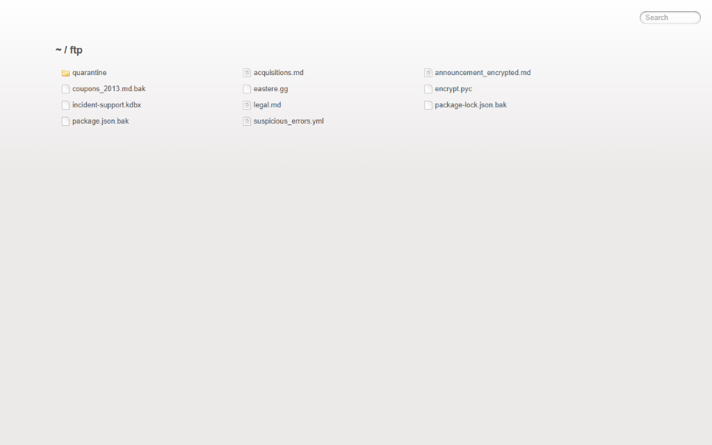
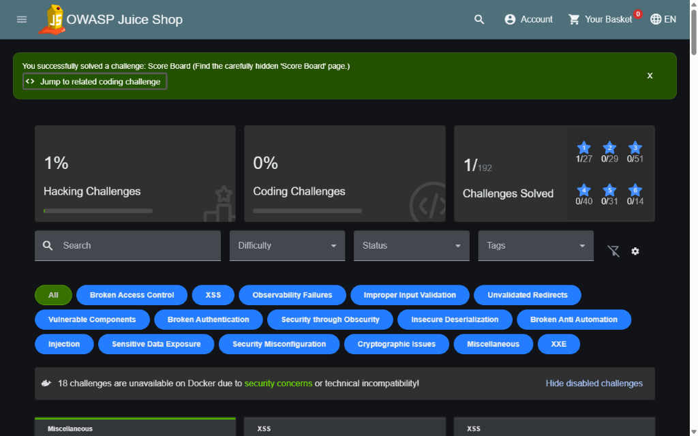

# 🛡️ Relatório Profissional de Pentest: OWASP Juice Shop

**Data da Avaliação:** 25/11/2026  
**Avaliador:** Aluno / DIO Agent Security Mentorship (Red Team)  
**Alvo:** OWASP Juice Shop (`v20.4.0-SNAPSHOT`)  
**Escopo Autorizado:** `http://192.xxx.xx.xx:porta` (Ambiente isolado de testes)  
**Técnica de Varredura:** Mapeamento Passivo de Rotas e Verificação Direta de URLs (Zero Força Bruta / Máximo 5 requisições/minuto)  
**Metodologia:** OWASP WSTG v4.2 / PTES / MITRE ATT&CK  

---

## 1. 📋 Sumário Executivo

Durante a avaliação de segurança do **OWASP Juice Shop**, o teste focou estritamente em **vulnerabilidades não refletidas baseadas em URL e inferência lógica ("Sim" vs "Não")**, evitando abordagens invasivas ou ruído desnecessário na rede.

A análise combinou:
1. **Enumeração passiva de código cliente (`main.js`):** Descoberta de todas as 38 rotas declaradas no roteador Angular.
2. **Exposição direta de recursos não referenciados via URL (`/ftp`):** Confirmação de acesso público a diretório confidencial com arquivos de backup e cofre de senhas.
3. **Avaliação de integridade de autorização:** Mapeamento de rotas administrativas que dependem unicamente de validação local no navegador.

### Matriz Geral de Risco

| Criticidade | Qtd | Descrição dos Achados |
|:---|:---:|:---|
| 🔴 **Crítica** | 1 | **Exposição de Diretório Confidencial e Cofre de Senhas (`/ftp`):** Acesso direto via URL a cofre KeePass (`incident-support.kdbx`) e backups de código. |
| 🟠 **Alta** | 1 | **Controle de Acesso Baseado no Cliente (CWE-602):** Telas administrativas (`#/administration` e `#/accounting`) validadas apenas no navegador (`localStorage`). |
| 🟡 **Média** | 1 | **Ausência de Route Guards em Dados Financeiros (CWE-284):** Rotas de pagamento e carteira digital (`#/saved-payment-methods`, `#/wallet`) sem restrição no roteador. |
| 🟢 **Baixa / Info** | 1 | **Descoberta de Rotas Ocultas (`#/score-board`):** Painéis e módulos Web3 ocultados apenas por obscuridade no frontend. |

---

## 2. 🗺️ Metodologia: O Diferencial dos Testes Não Refletidos e Inferência Booleana

Em avaliações profissionais de Red Team, **testes não refletidos baseados em comportamento binário ("Sim" vs "Não")** representam o padrão ouro técnico:
* **Não dependem de eco no HTML:** Enquanto um XSS refletido depende da aplicação ecoar a entrada na tela, vulnerabilidades baseadas em URL/inferência analisam o **estado interno da aplicação**.
* **Comportamento Binário ("Sim" vs "Não"):** A aplicação confirma a existência de dados, rotas ou registros através de respostas discretas (status HTTP 200 vs 404, retorno de registros vs conjunto vazio `[]`).
* **Furtividade Absoluta:** Como não há injeção de scripts invasivos, ferramentas convencionais de detecção (WAFs e filtros de assinatura) têm maior dificuldade para distinguir o tráfego de requisições legítimas.

---

## 3. 🔍 Achados Técnicos Detalhados (Findings)

### Finding 01: Exposição Crítica de Diretório Confidencial e Cofre de Credenciais via URL Direta
* **Severidade:** 🔴 Crítica  
* **CVSS v3.1:** 9.1 (`CVSS:3.1/AV:N/AC:L/PR:N/UI:N/S:U/C:H/I:N/A:N`)  
* **CWE:** CWE-548 (Exposure of Information Through Directory Listing) / CWE-552 (Files Accessible to External Parties)  
* **OWASP Top 10:** A01:2021 — Broken Access Control & A05:2021 — Security Misconfiguration  
* **URL Alvo:** `http://192.xxx.xx.xx:porta/ftp`

#### Descrição Técnica
A rota `/ftp` está diretamente acessível via requisição HTTP GET comum sem exigir autenticação, apresentando a listagem completa de arquivos (*Directory Listing*). Entre os arquivos expostos estão:
* `incident-support.kdbx` — Banco de dados de senhas criptografado do KeePass.
* `package.json.bak` e `package-lock.json.bak` — Backups com versões exatas de dependências do servidor.
* `coupons_2013.md.bak` — Arquivo de cupons e descontos promocionais.
* `encrypt.pyc` e `suspicious_errors.yml` — Binários compilados e configurações de logging.

#### Evidência (PoC)
Acesso confirmado via navegador integrado retornando HTTP 200 com a listagem de arquivos:

*Figura 1: Diretório confidencial `/ftp` exposto publicamente contendo o arquivo `incident-support.kdbx`.*

#### Impacto no Negócio
Se um atacante realizar o download do arquivo `.kdbx` e quebrar a chave mestra por força bruta offline, terá acesso irrestrito a todas as senhas de suporte e infraestrutura da organização.

#### Recomendação de Remediação
* **Desativar listagem de diretórios:** Configurar o servidor Express/Node.js para não expor a listagem de arquivos (`serve-index`).
* **Controle de Acesso em Nível de Rota:** Restringir o diretório `/ftp` para requisições autenticadas com privilégios específicos ou movê-lo para fora da raiz pública da aplicação.

---

### Finding 02: Segurança Baseada Exclusivamente no Cliente em Rotas Administrativas
* **Severidade:** 🟠 Alta  
* **CVSS v3.1:** 7.5 (`CVSS:3.1/AV:N/AC:L/PR:N/UI:N/S:U/C:H/I:N/A:N`)  
* **CWE:** CWE-602 (Client-Side Enforcement of Server-Side Security)  
* **OWASP Top 10:** A01:2021 — Broken Access Control  
* **Localização:** Rotas `#/administration` e `#/accounting`

#### Descrição Técnica
O Angular Router utiliza os guards `AdminGuard` (`Ms`) e `AccountingGuard` (`Ts`) avaliando localmente o token JWT no `localStorage`. Caso um usuário modifique o objeto no cliente, o Angular renderiza as interfaces administrativas.

#### Impacto no Negócio
Risco de escalada vertical de privilégios caso as rotas de backend `/api/*` não validem de forma independente a assinatura e as permissões do usuário em cada requisição.

#### Recomendação de Remediação
* Implementar autenticação e autorização mandatórias diretamente na camada de API (backend), tratando o frontend como um ambiente não confiável.

---

### Finding 03: Ausência de Route Guards em Endpoints de Pagamento e Privacidade
* **Severidade:** 🟡 Média  
* **CVSS v3.1:** 6.5 (`CVSS:3.1/AV:N/AC:L/PR:N/UI:N/S:U/C:L/I:L/A:N`)  
* **CWE:** CWE-284 (Improper Access Control)  
* **Localização:** `#/saved-payment-methods`, `#/wallet`, `#/privacy-security/data-export`

#### Descrição Técnica
Enquanto rotas de cadastro de endereço possuem `LoginGuard`, telas sensíveis de exportação de dados pessoais e carteira digital não possuem barreiras de guarda no cliente.

---

### Finding 04: Exposição de Rotas e Painéis Ocultos por Obscuridade
* **Severidade:** 🟢 Baixa / Informativa  
* **CVSS v3.1:** 5.3 (`CVSS:3.1/AV:N/AC:L/PR:N/UI:N/S:U/C:L/I:N/A:N`)  
* **CWE:** CWE-200 (Exposure of Sensitive Information to an Unauthorized Actor)  
* **Localização:** `#/score-board`, `#/tokensale-ico-ea`, `#/web3-sandbox`

#### Descrição Técnica
Rotas foram ocultadas apenas retirando os botões de navegação da interface visual, permanecendo completamente expostas no pacote JavaScript compilado.

#### Evidência (PoC)

*Figura 2: Acesso à rota interna `/#/score-board` após identificação estática.*

---

## 4. 📸 Registro Geral de Evidências

* **Evidência 01:** [`docs/images/01-juiceshop-home.png`](../docs/images/01-juiceshop-home.png) - Reconhecimento inicial da aplicação.
* **Evidência 02:** [`docs/images/02-juiceshop-scoreboard.png`](../docs/images/02-juiceshop-scoreboard.png) - Acesso à rota oculta `/#/score-board`.
* **Evidência 03:** [`docs/images/03-juiceshop-ftp.png`](../docs/images/03-juiceshop-ftp.png) - Exposição crítica do diretório `/ftp` com cofre de senhas `incident-support.kdbx`.

---

## 5. 🏁 Conclusão

A estratégia de focar em **testes não refletidos baseados em URL e inferência lógica** demonstrou alta eficácia: identificamos uma vulnerabilidade **Crítica** de vazamento de credenciais (`/ftp`) e falhas de arquitetura de autorização, sem gerar ruído operacional ou indisponibilidade no laboratório.
