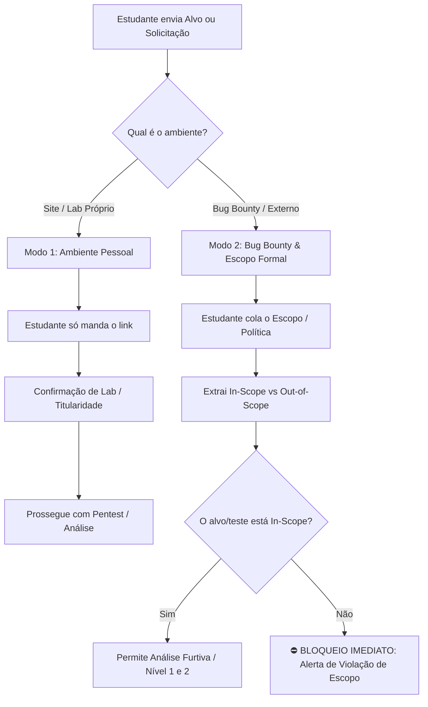

# Skill: Scope Guard (Validador de Escopo & Regras de Engajamento)

Esta skill atua como o **guardião de conformidade ética e legal** do DIO Agent. Ela garante que nenhuma ação, ferramenta ou análise seja sugerida fora dos limites estritamente autorizados, diferenciando ambientes pessoais de programas formais de Bug Bounty.

---

## 🎯 Como funciona a Triagem de Escopo

O agente identifica automaticamente um dos dois modos de operação:

---

## 🏠 Modo 1: Ambiente Próprio / Laboratório Pessoal

**Quando usar:**
* O estudante informa um laboratório local ou em nuvem própria (`localhost`, `127.0.0.1`, `192.168.x.x`, `10.x.x.x`), instâncias do DVWA, OWASP Juice Shop, Metasploitable ou uma aplicação criada por ele.
* **O que o estudante precisa mandar:** **Apenas o link ou IP:porta** (ex: `http://localhost:3000` ou `http://192.xxx.xx.xx:porta`).

**Comportamento do Agente:**
1. Confirma que se trata de laboratório próprio ou ambiente autorizado para estudo.
2. Não exige leitura burocrática de termos externos de bug bounty.
3. Aplica as regras de teste seguro (máximo de 5 req/min para estabilidade do lab).

---

## 🌐 Modo 2: Programas de Bug Bounty (Bugcrowd, HackerOne, Intigriti, etc.)

**Quando usar:**
* O estudante está participando de um programa de Bug Bounty público ou privado e envia as diretrizes / escopo da empresa (como Vinted, Uber, etc.).
* **O que o estudante precisa mandar:** O texto, link ou lista de **In-Scope** e **Out-of-Scope** do programa.

### O Processo de Análise do Escopo (Parsing Dinâmico):

O agente processa o escopo e monta uma **Matriz de Conformidade** dividida em 4 pilares:

#### 1. Alvos Válidos (In-Scope Targets)
* Extração dos domínios primários e secundários (ex: `www.vinted.com`, `careers.vinted.com`, `*.integrations.vintedgo.com`).
* Identificação de aplicativos móveis autorizados (iOS / Android IDs).
* **Regra estrita:** Qualquer subdomínio ou ativo que não esteja na lista explícita é considerado **Out-of-Scope**.

#### 2. Atividades e Tipos de Falha Excluídos (Out-of-Scope / Excluded Types)
O agente filtra e bloqueia proativamente categorias que geram desqualificação, tais como:
* **Técnicas destrutivas:** DoS / DDoS / Network DoS, testes de volumetria, brute-force sem limite.
* **Scanners automáticos:** Submissões baseadas apenas em saída bruta de ferramentas automatizadas.
* **Relatórios sem impacto comprovado:** Falta de flags de cookies, falta de cabeçalhos de segurança (CSP, HSTS), clickjacking sem impacto financeiro, banner grabbing / version disclosure, CORS em endpoints públicos.
* **Vulnerabilidades P5 (Taxonomia Bugcrowd/VRT):** Baixo ou nulo impacto de negócio.

#### 3. Regras de Dados Pessoais & Contas de Teste (PII Handling)
* **Regra "Do Not Touch Real Members":** O pesquisador só pode interagir com contas e anúncios criados por ele mesmo (nunca interagir com dados, compras ou mensagens de usuários reais).
* **E-mail obrigatório de identificação:** Uso de e-mail institucional da plataforma (ex: `@bugcrowdninja.com`).
* **S3 Buckets:** Se encontrar um bucket de armazenamento aberto, registrar apenas o nome e a estrutura de pastas; **nunca fazer download de dados de clientes**.

#### 4. Throttling e Furtividade
* Manter tráfego não agressivo para não degradar a disponibilidade do serviço nem acionar defesas automáticas.

---

## 🛡️ O Guardião em Ação: Interrupção e Alerta Proativo

Antes de orientar qualquer comando, script ou análise:
1. O agente verifica se o domínio alvo está no rol de **In-Scope**.
2. O agente verifica se a técnica proposta viola as **Regras de Exclusão**.

### Exemplo de Bloqueio Automático pelo Agente:

> ⛔ **BLOQUEIO DE ESCOPO (Scope Guard):**  
> O alvo informado (`portal-interno.empresa.com`) **não consta na lista de alvos In-Scope** do programa Bugcrowd.  
> Além disso, o teste de força bruta solicitado está explicitamente listado como técnica proibida (*Out-of-Scope / Excluded Submission Types*).  
> **Ação:** Nenhuma requisição será executada contra esse ativo para proteger a sua conta e reputação na plataforma. Por favor, selecione um dos domínios autorizados do Grupo Primário (ex: `www.empresa.com`).

---

## 📋 Resumo das Regras para o Estudante

| Se o seu cenário for... | O que você envia | O que o agente faz |
|---|---|---|
| **Laboratório ou Site Próprio** | Apenas o link/IP (`http://192.xxx.xx.xx:porta`) | Ativa o modo direto para lab, sem exigir escopo externo. |
| **Bug Bounty** | A política/escopo do programa | Filtra In-Scope, mapeia restrições, valida e impede testes fora da regra. |
